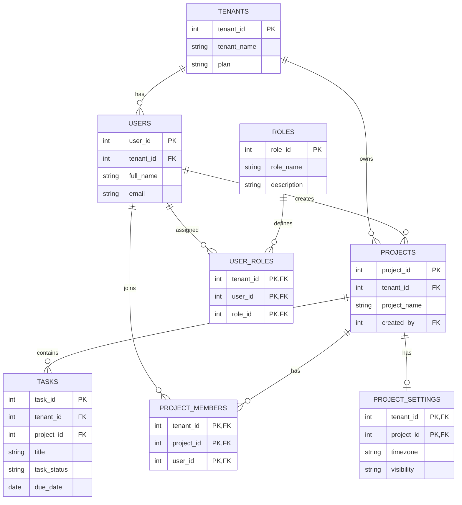

# Entity Relationship Diagram

## Database: Multi-Tenant SaaS Project Management System

## Relationships

- **One-to-Many (1:N):** One tenant can have many users and projects.
- **One-to-Many (1:N):** One project can contain many tasks.
- **Many-to-Many (N:M):** Users can join many projects through `project_members`.
- **Many-to-Many (N:M):** Users can have many roles through `user_roles`.
- **One-to-One (1:1):** A project can have at most one settings record through `project_settings`.
